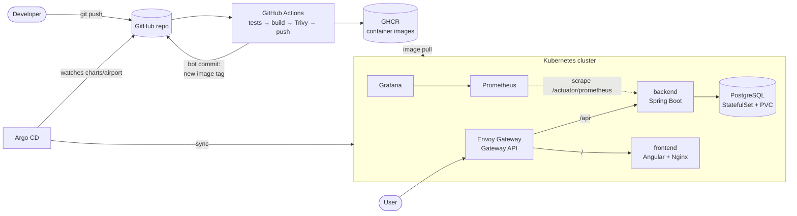

# Airport Management System — DevOps & Cloud


End-to-end DevOps platform for a real web application: an **Angular / Spring Boot / PostgreSQL** airport
management system (my university project), containerized, tested and scanned in CI, packaged with Helm,
deployed by **GitOps (Argo CD)** on Kubernetes, monitored with **Prometheus / Grafana**, and provisioned on
**AWS with Terraform**.

> The application itself (features, API, database) is documented in [docs/APPLICATION.md](docs/APPLICATION.md).
> This README focuses on the DevOps work.

---

## Architecture



**Flow:** a `git push` on application code runs the tests, builds both images, scans them with Trivy,
publishes them to GHCR tagged with the commit SHA, then a bot commits the new tag into the Helm chart.
Argo CD detects the commit and performs a zero-downtime rolling update. Nobody runs `kubectl apply` by hand.

---

## Tech stack

| Area | Tools |
|---|---|
| Application | Angular 21, Spring Boot 4.1 (Java 21), PostgreSQL 18, Flyway |
| Containers | Docker (multi-stage builds), Docker Compose |
| CI | GitHub Actions, Trivy (vulnerability + secret scanning), GHCR |
| Kubernetes | kind (local), k3s (AWS), Helm 4, Gateway API with Envoy Gateway |
| GitOps / CD | Argo CD (automated sync, self-heal, prune) |
| Observability | kube-prometheus-stack (Prometheus, Grafana, Alertmanager), Spring Boot Actuator + Micrometer, k6 |
| Cloud / IaC | AWS (VPC, EC2, Security Groups, IAM), Terraform 1.17 |

---

## What this project demonstrates

- **Containerization** — multi-stage Dockerfiles: the final images contain only what is needed at runtime
  (backend ≈ 164 MB, frontend ≈ 26 MB compressed), non-root user for the backend, Nginx reverse proxy for the SPA.
- **CI with security gates** — tests (JUnit, Vitest) must pass before any image is built; Trivy blocks any
  image with a CRITICAL vulnerability. The pipeline caught 7 critical CVEs (Tomcat, Spring MVC), fixed by
  upgrading the Spring Boot BOM from 4.1.0 to 4.1.2.
- **Supply-chain hygiene** — the Trivy action is pinned by commit SHA (following the March 2026
  `trivy-action` tag-poisoning incident); least-privilege `permissions:` per job; secrets never stored in Git.
- **Immutable, traceable releases** — images tagged with the Git commit SHA instead of `latest`.
- **GitOps** — Git is the single source of truth; Argo CD reverts any manual change in the cluster.
- **Kubernetes fundamentals** — Deployments with startup / readiness / liveness probes, a StatefulSet with
  persistent storage, ConfigMaps and Secrets, resource requests and limits, rolling updates and rollbacks.
- **Modern ingress** — Gateway API with Envoy Gateway (ingress-nginx reached end of life in March 2026).
- **Observability** — application metrics (HTTP requests, latency histograms, JVM) collected through a
  `ServiceMonitor`, Grafana dashboards, k6 load test with p95 latency thresholds.
- **Infrastructure as Code** — the AWS network and server are fully described in Terraform and can be
  created or destroyed in minutes.
- **Cloud cost and security discipline** — MFA, dedicated IAM user, short-lived credentials (`aws login`,
  no long-term access keys), zero-spend budget alert, audit and removal of orphaned resources.

---

## Repository structure

```
.
├── .github/workflows/ci.yml   # CI: tests → build → Trivy → push → GitOps tag update
├── backend/                   # Spring Boot API + Dockerfile
├── frontend/                  # Angular app + Dockerfile + nginx.conf
├── compose.yaml               # Run the whole stack locally with Docker Compose
├── charts/airport/            # Helm chart of the application
│   ├── values.yaml            #   default values (image tags updated by CI)
│   └── values-aws.yaml        #   overrides for the AWS k3s server
├── argocd/airport-app.yaml    # Argo CD Application (GitOps)
├── k8s/                       # Cluster-level resources: kind config, namespace, GatewayClass
├── monitoring/values.yaml     # kube-prometheus-stack configuration
├── k6/load-test.js            # Load test scenario
└── infra/terraform/           # AWS: VPC, subnet, security group, EC2 + k3s bootstrap
```

---

## CI/CD pipeline

| Job | What it does |
|---|---|
| `backend-tests` | Java 21, `mvn test` (JUnit 5, Mockito) |
| `frontend-tests` | Node 24, `npm ci`, Vitest, production build |
| `build-scan-push` (matrix: backend, frontend) | Build with Buildx and GHA cache → Trivy scan (fails on CRITICAL) → push `ghcr.io/alajouili/airport-*:<sha>` |
| `update-manifests` | Writes the new SHA into `charts/airport/values.yaml` with `yq` and commits it (`[skip ci]`) |

Commits that only touch `charts/`, `k8s/`, `argocd/`, `monitoring/`, `infra/`, `k6/` or Markdown files
do not trigger the build: Argo CD handles chart changes on its own.

---

## Quick start

### 1. Docker Compose (simplest)

```bash
cp .env.example .env          # then set your own values
docker compose up -d --build
# open http://localhost
```

### 2. Local Kubernetes (kind) with GitOps

Prerequisites: Docker, kubectl, kind, Helm.

```bash
# Cluster
kind create cluster --config k8s/kind-config.yaml
docker run -d --name cloud-provider-kind --restart unless-stopped --network kind \
  -v /var/run/docker.sock:/var/run/docker.sock \
  registry.k8s.io/cloud-provider-kind/cloud-controller-manager:v0.12.0

# Gateway API + Envoy Gateway
kubectl apply --server-side -f https://github.com/envoyproxy/gateway/releases/download/v1.10.0/install.yaml
kubectl apply -f k8s/gatewayclass.yaml -f k8s/namespace.yaml

# Database secret (never committed)
kubectl create secret generic db-credentials -n airport \
  --from-literal=DB_NAME=airport_db \
  --from-literal=DB_USERNAME=postgres \
  --from-literal=DB_PASSWORD="$(openssl rand -base64 18)"

# Monitoring
helm install monitoring oci://ghcr.io/prometheus-community/charts/kube-prometheus-stack \
  --version 93.3.0 -n monitoring --create-namespace -f monitoring/values.yaml

# Argo CD, then hand the application over to GitOps
kubectl create namespace argocd
kubectl apply -n argocd --server-side --force-conflicts \
  -f https://raw.githubusercontent.com/argoproj/argo-cd/v3.6.1/manifests/install.yaml
kubectl apply -f argocd/airport-app.yaml

# Application URL
kubectl get gateway airport-gateway -n airport
```

### 3. AWS (Terraform + k3s)

Prerequisites: AWS CLI ≥ 2.32 (`aws login`), Terraform ≥ 1.10, an SSH key in `~/.ssh/id_ed25519.pub`.

```bash
cd infra/terraform
echo "my_ip_cidr = \"$(curl -s https://checkip.amazonaws.com)/32\"" > terraform.tfvars
terraform init
terraform apply                  # VPC, subnet, security group, EC2 with k3s

# Then: copy /etc/rancher/k3s/k3s.yaml from the server, install Envoy Gateway,
# create the secret and run:
helm install airport ../../charts/airport -n airport -f ../../charts/airport/values-aws.yaml

terraform destroy                # always destroy at the end of a session
```

The server is a free-tier-eligible `c7i-flex.large` (2 vCPU, 4 GB). SSH and the Kubernetes API are only
open to the operator's IP; only HTTP (80) is public. IMDSv2 is enforced and the root volume is encrypted.

---

## Problems solved along the way

| Problem | Root cause | Fix |
|---|---|---|
| Frontend missing from the repository | Angular CLI had created a nested Git repo (gitlink) | Removed the nested `.git`, re-added the sources |
| Pipeline blocked by Trivy (7 CRITICAL) | Outdated Tomcat and Spring MVC pulled by Spring Boot 4.1.0 | Upgraded the Spring Boot BOM to 4.1.2 |
| PostgreSQL created the wrong database | Secret key mapping mistake in the manifest | Diagnosed with `printenv` in the pod, fixed the manifest, re-initialized the volume |
| Rolling update stuck for 30+ minutes | New image never finished downloading (slow network) | Detected via pod status and Grafana; preloaded the image into the node |
| Cloud credits silently consumed | Orphaned Auto Scaling Group, ALB and EFS from an older project | Billing analysis per service/region, deleted the ASG first, then the rest |
| `/actuator/prometheus` returned 500 | Endpoint not exposed + catch-all exception handler mapping 404 to 500 | Exposed the endpoint; identified the handler bug |

---

## Roadmap

- HTTPS with a domain name, cert-manager and Let's Encrypt (mobile browsers force HTTPS)
- Prometheus alert rules (`PrometheusRule`) routed through Alertmanager
- Terraform remote state in S3 with locking
- Private subnet for the server in a production setup
- Map `NoResourceFoundException` to 404 in the backend exception handler
- Manage the monitoring stack with Argo CD as well

---

## Author

**Ala Jouili** — DevOps & Cloud
